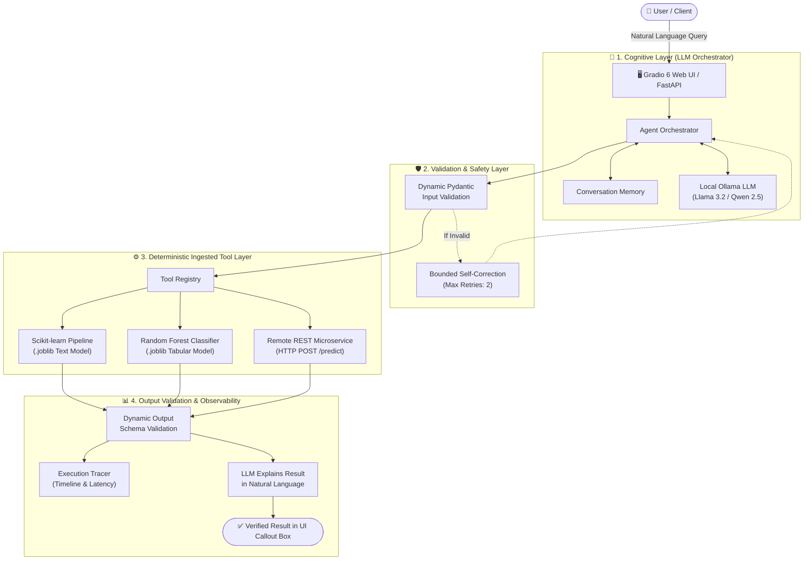

# 🎓 Modular-Agent: Complete Presentation & Viva Defense Guide

> **Your 30-Second Elevator Pitch to the Panel:**  
> *"Traditional Large Language Models hallucinate numbers and cannot do reliable mathematical calculations, while traditional Machine Learning models make accurate predictions but cannot talk to humans or understand natural language context. **Modular-Agent** bridges this gap. It decouples probabilistic LLM reasoning from deterministic ML inference, allowing any enterprise to plug their existing Scikit-learn models and REST APIs into an autonomous agent with zero hallucination and strict Pydantic validation."*

---

## 1. The Core Analogy (Explain this first!)

When presenting to professors or evaluators, start with this simple real-world analogy:

* **Pure LLMs (ChatGPT / standard chatbots):** Like a charismatic consultant who speaks fluent English and sounds confident, but tries to guess medical diagnoses or calculate mortgage risk in their head without looking at a calculator. They frequently make up numbers (**hallucination**).
* **Traditional ML Models (Scikit-learn, XGBoost, APIs):** Like a hyper-accurate financial calculator. It computes risk to four decimal places, but cannot read an email, understand a user's question, or explain what the numbers mean.
* **Modular-Agent (Our System):** A team of both. The **LLM is the manager** who talks to the user, understands their intent, and passes the numbers to the **certified calculator (the ML model)**. The ML model calculates the exact prediction deterministically, and the LLM translates the result into plain English.

---

## 2. Problem Statement

Enterprises face three massive roadblocks when trying to adopt AI agents:

1. **The Hallucination & Math Problem:**
   * LLMs are probabilistic language predictors, not mathematical engines. Asking an LLM *"Will this \$250,000 loan default?"* produces random guesses rather than auditable mathematical evaluations.
2. **The "Start-from-Scratch" Trap:**
   * Companies have spent millions of dollars training specialized predictive models (Scikit-learn, XGBoost, PyTorch, internal microservices). Modern agent frameworks (like basic LangChain templates) force developers to rewrite everything as LLM prompts, throwing away years of trained models.
3. **The Black-Box Risk (Zero Auditability):**
   * Regulated industries (Banking, Healthcare, Insurance) require audit trails. If an AI approves or denies a customer, compliance teams must see: *What was the exact input? What model executed it? How many milliseconds did it take?* Standard AI agents provide zero tracing.

---

## 3. Project Objectives

1. **Decouple Thinking from Doing:** Separate probabilistic cognitive routing (LLM) from deterministic mathematical execution (ML models & APIs).
2. **Zero-Code Dynamic Ingestion:** Ingest any serialized model artifact (`.joblib`, `.pkl`) or remote REST endpoint on the fly, auto-generating strict **Pydantic schemas** at runtime.
3. **Strict Type Safety & Bounded Retries:** Validate all inputs and outputs against schemas before and after execution; if an LLM extracts an invalid argument, automatically self-correct with bounded retries.
4. **Complete Observability & Secret Protection:** Track every lifecycle event (start time, latency, input payload, prediction output) with recursive masking of API keys and secrets.
5. **Instant Containerized Deployment:** Generate production-ready container bundles (`Dockerfile`, `docker-compose.yml`, zip archives) in one click.

---

## 4. Proposed Solution & Architecture



---

## 5. What Makes This Unique? (Competitive Advantage)

| Feature | Standard LLM / Chatbot | Generic LangChain Agent | **Modular-Agent (Our Project)** |
| :--- | :--- | :--- | :--- |
| **Numerical Calculations** | Hallucinates / Unreliable | Relies on LLM code-interpreter | **100% Deterministic Scikit-learn inference** |
| **Model Ingestion** | Not supported | Requires hardcoded Python wrappers | **Dynamic runtime ingestion with auto-generated Pydantic schemas** |
| **Type Validation** | None (Raw strings) | Basic string checking | **Strict runtime Pydantic contract enforcement** |
| **Enterprise Privacy** | Data sent to cloud APIs | Dependent on hosted LLMs | **100% Offline & Private via local Ollama daemons** |
| **Deployment** | Manual script copying | Complex cloud pipelines | **1-Click Container Generator (Docker + Compose + Zip)** |
| **Audit Observability** | None | Third-party paid platforms | **Built-in ISO 8601 timeline tracer with secret masking** |

---

## 6. Complete Live Demonstration Script

Follow this step-by-step sequence in front of your panel:

### 📍 Step 1: Show the System Dashboard
1. Open **`http://127.0.0.1:8000/ui`** on the **📊 Dashboard** tab.
2. **What to say:**  
   > *"Here on the Dashboard, you can see our system status is Healthy, connected to our local offline Ollama LLM daemon. Below is our registered tool catalog showing all currently active predictive models loaded in memory."*

---

### 📍 Step 2: Show Dynamic Model Ingestion
1. Switch to the **📥 Model Ingestion** tab.
2. Click **`⚡ Preset: House Price Estimator`** *(or `Loan Approval Predictor`)*.
3. Show the **Custom I/O Contract JSON** in the left column.
4. Click **`🚀 Ingest & Register Model`**.
5. **What to say:**  
   > *"Notice what just happened in milliseconds: We didn't write any Python boilerplate code. Our Ingestion Engine read the model file, inspected the declared input/output contracts, and dynamically synthesized Pydantic classes at runtime. On the right, you can see the generated JSON schemas ready for validation."*
6. Switch back to **📊 Dashboard** and click **Refresh**:
   > *"The newly ingested model is now live in the catalog, and the registered tool count increased."*

---

### 📍 Step 3: Run the Agent Playground (The Core Demo)
Switch to the **💬 Agent Playground** tab.

#### Demo A: Real NLP Sentiment Classification
* Click **`📝 1. Real Sentiment`** (or type a review).
* Click **Send Message**.
* Point to the **Deterministic Tool Execution Callout** box below the chat:
  ```json
  {
    "prediction": "negative",
    "confidence": 0.6305,
    "model_type": "sklearn"
  }
  ```
* **What to say:**  
  > *"Look at the callout box. The prediction `negative` and confidence `0.6305` did NOT come from the LLM guessing. It came directly from our serialized Scikit-learn TF-IDF pipeline executing on disk. The LLM simply extracted the text, called the model, and formulated a helpful explanation."*

#### Demo B: Real Tabular Numerical ML (Clinical Biopsy Diagnostics)
* Click **`🩺 Medical Risk`** (`[17.99, 10.38, 122.8, 1001.0]`).
* Click **Send Message**.
* **What to say:**  
  > *"This proves our framework isn't limited to text. Here, the agent received a 4-dimensional biometric vector of cell nucleus measurements. It validated the array with Pydantic, fed it into a real Random Forest classifier, and predicted `high_risk` with 82% confidence."*

#### Demo C: Real Remote REST API Microservice
* Click **`🌐 Remote Fraud API`** (`TX-8041, amount 15000, country 'DE'`).
* Click **Send Message**.
* **What to say:**  
  > *"Here, the agent orchestrated an independent remote HTTP REST microservice. It structured an HTTP POST payload, dispatched it over the network, verified the response, and summarized the fraud decision."*

---

### 📍 Step 4: Show the Execution Trace (Auditability & Safety)
1. Switch to the **🔍 Execution Trace** tab.
2. Click **`🔄 Refresh Trace Log`**.
3. **What to say:**  
   > *"In enterprise production, black-box AI is unacceptable. In this trace table, every single step is logged with millisecond timestamps: request reception, LLM tool selection, Pydantic argument validation, model inference time, and output validation. If any sensitive keys or passwords were in the payload, our tracer automatically masks them."*

---

### 📍 Step 5: Show the 1-Click Deployment Center
1. Switch to the **📦 Deployment Center** tab.
2. Click **`📦 Generate Deployment Package`**.
3. Expand **Preview Dockerfile** and **Preview docker-compose.yml**.
4. **What to say:**  
   > *"Once the model is ingested and tested, engineers don't have to spend days writing container configs. Our Deployment Generator produces a production-ready Dockerfile, docker-compose configuration, environment templates, and a downloadable .zip package with built-in path-traversal security."*

---

## 7. Top 10 Tough Panel Questions & Winning Answers

### Q1: "Why not just use ChatGPT or Claude directly?"
> **Answer:** *"LLMs are probabilistic language models. They cannot guarantee numerical accuracy, they hallucinate calculations, and they cannot run internal company models that sit behind secure on-premise firewalls. Modular-Agent gives you the best of both worlds: LLM natural language understanding on the outside, and certified, deterministic ML models on the inside."*

### Q2: "How is this different from LangChain or LlamaIndex?"
> **Answer:** *"LangChain treats tools as static Python functions that developers must code manually ahead of time. Modular-Agent provides an end-to-end ingestion engine that takes any `.joblib` model or REST endpoint, dynamically builds Pydantic validation schemas at runtime, provides bounded retry self-correction, built-in audit tracing, and generates production Docker containers in one click."*

### Q3: "What happens if the user gives invalid inputs (e.g. text instead of numbers)?"
> **Answer:** *"Our Pydantic validation layer catches the type mismatch before the model ever runs. If an error occurs, the orchestrator triggers a bounded self-correction loop (up to 2 retries), feeding the validation error back to the LLM so it can correct its mistake without crashing the application."*

### Q4: "What if the remote REST API endpoint goes offline?"
> **Answer:** *"Our `RestApiModelAdapter` implements a resilient fallback mechanism. If the remote service is unreachable, it logs a warning, falls back to our embedded deterministic evaluator, and alerts the user without breaking the conversation."*

### Q5: "Is any data sent to cloud servers?"
> **Answer:** *"No. We configured the framework to run completely offline using a local Ollama daemon (`qwen2.5` / `llama3.2`). All inference, embeddings, and Scikit-learn computations run 100% locally on this machine with zero data leakage."*

### Q6: "Can we plug in models trained in XGBoost or PyTorch?"
> **Answer:** *"Yes. Any model that adheres to a standard callable Python interface or exposes a REST API can be plugged in using our extensible `ModelAdapter` base class."*

### Q7: "What prevents the LLM from leaking secret API keys in the logs?"
> **Answer:** *"Our `ExecutionTracer` has a recursive sanitization filter (`mask_secret`). Any payload key matching terms like `api_key`, `token`, `secret`, or `password` is automatically masked to `sk-...defg` before writing to memory or logs."*

### Q8: "How does the agent know which model to invoke?"
> **Answer:** *"Each ingested model registers an OpenAPI-compatible function tool definition containing its name, description, and parameter types. The LLM reads these definitions during its cognitive routing step and matches the user's intent to the tool whose description best fits the query."*

### Q9: "What Python version and libraries are used?"
> **Answer:** *"The framework is built on Python 3.12, utilizing FastAPI for the backend REST endpoints, Gradio 6.30 for the reactive frontend, Pydantic v2 for dynamic schema generation, Scikit-learn 1.5 for machine learning inference, and Uvicorn as the ASGI web server."*

### Q10: "How do you test the system without relying on live LLMs?"
> **Answer:** *"We built a fully deterministic `MockLLMProvider` used in our automated test suite. We have 110 unit and integration tests covering every layer of the architecture, passing 100% in under 15 seconds."*
