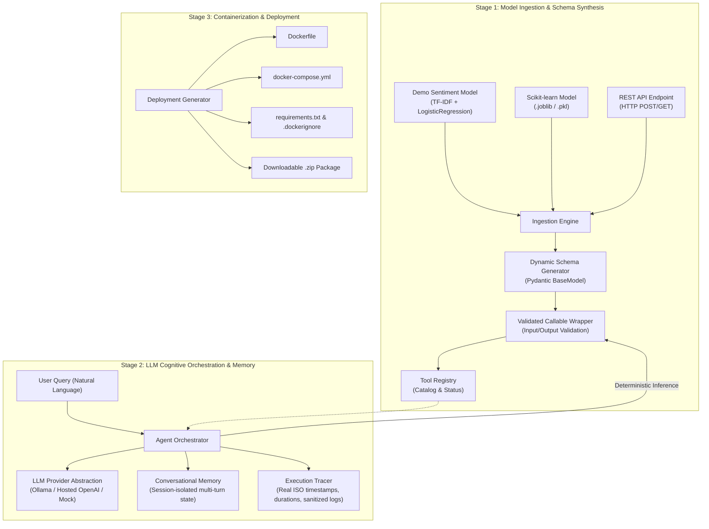

# Modular-Agent: Decoupled Predictive ML to LLM Agent Framework

A production-grade, decoupled software framework that converts supported predictive machine learning models and API endpoints into LLM-orchestrated autonomous agents.

Modular-Agent enforces an architectural boundary separating **deterministic predictive model inference** from **probabilistic LLM cognitive orchestration**.

---

## 1. Project Architecture

The system demonstrates three decoupled architectural stages:



---

## 2. Technology Stack & Python Version

- **Runtime**: Python `3.12` (tested on Python `3.12.8`)
- **Web API**: FastAPI `0.162.0`, Uvicorn `0.30.6`
- **Interactive UI**: Gradio `6.30.0`
- **Data Validation & Schemas**: Pydantic `2.9.2`, Pydantic Settings `2.5.2`
- **Machine Learning**: Scikit-learn `1.5.2`, NumPy `2.5.4`, Joblib `1.6.0`
- **HTTP Client**: HTTPX `0.27.2`
- **Test Framework**: Pytest `8.3.3` (108 unit & integration tests)
- **Containerization**: Docker, Docker Compose

---

## 3. Supported Model Types

| Model Type | Adapter Class | Description | Input Format | Confidence Output |
|---|---|---|---|---|
| `demo` | `DemoSentimentModel` | Built-in sentiment classifier (TF-IDF + LogisticRegression) doing real inference | `{"text": "..."}` (str) | Raw logistic probability `[0.0, 1.0]` |
| `sklearn` | `SklearnModelAdapter` | Deserialized `.joblib` / `.pkl` scikit-learn models and pipelines | `{"features": [...]}` (list of numbers) or custom | Max class probability if `predict_proba` is available |
| `rest_api` | `RestApiModelAdapter` | Remote or local HTTP REST model inference endpoint | `{"query": "..."}` or custom payload | Derived from remote JSON payload |

---

## 4. LLM Provider Abstraction & Setup

The framework decouples cognitive reasoning from concrete model backends via `BaseLLMProvider`.

### Supported Providers:

1. **Mock Provider (`mock`)** *(Default)*:
   - Completely deterministic, offline test provider.
   - Automatically detects sentiment and prediction queries to select registered tools.
   - Requires zero external services or API keys.

2. **Ollama Local LLM (`ollama`)**:
   - Runs local open-weights models (e.g., `llama3.1`, `mistral`, `qwen2.5`).
   - Prerequisites: Install [Ollama](https://ollama.com/) and run:
     ```bash
     ollama pull llama3.1
     ollama serve
     ```
   - Configuration in `.env`:
     ```env
     MA_LLM_PROVIDER=ollama
     MA_LLM_MODEL=llama3.1
     MA_LLM_BASE_URL=http://localhost:11434
     ```

3. **Hosted OpenAI-Compatible Provider (`hosted` or `openai`)**:
   - Compatible with OpenAI (`gpt-4o-mini`), OpenRouter, Groq, vLLM, DeepSeek.
   - Configuration in `.env`:
     ```env
     MA_LLM_PROVIDER=hosted
     MA_LLM_MODEL=gpt-4o-mini
     MA_LLM_BASE_URL=https://api.openai.com/v1
     MA_LLM_API_KEY=your_secret_api_key_here
     ```
   - **Security**: API keys are strictly masked (`sk-...defg`) and never exposed in logs, execution traces, or frontend responses.

---

## 5. Installation & Setup

### Step 1: Clone and Navigate
```bash
git clone <repo_url>
cd modular_agent
```

### Step 2: Create Virtual Environment
```bash
python -m venv .venv

# Windows (PowerShell):
.venv\Scripts\Activate.ps1

# Linux / macOS:
source .venv/bin/activate
```

### Step 3: Install Dependencies
```bash
pip install -r requirements.txt
pip install --no-build-isolation --no-deps -e .
```

### Step 4: Environment Configuration
```bash
# Windows (PowerShell):
Copy-Item .env.example .env

# Linux / macOS:
cp .env.example .env
```

---

## 6. Running the Application

### Option A: Unified Application (FastAPI REST API + Mounted Gradio UI)
```bash
uvicorn modular_agent.api.app:app --host 0.0.0.0 --port 8000 --reload
```
- **Interactive Gradio Web Interface**: [`http://localhost:8000/ui`](http://localhost:8000/ui) (or [`http://localhost:8000`](http://localhost:8000))
- **Health Check**: [`http://localhost:8000/health`](http://localhost:8000/health)
- **Tools Inventory**: [`http://localhost:8000/tools`](http://localhost:8000/tools)
- **OpenAPI Swagger Documentation**: [`http://localhost:8000/docs`](http://localhost:8000/docs)

### Option B: Dedicated Gradio UI Runner
```bash
python -m modular_agent.ui.app
```
Opens the interactive Gradio dashboard on [`http://localhost:7860`](http://localhost:7860).

---

## 7. Web Interface Walkthrough (Gradio)

The web interface is organized into five functional tabs:

1. **Dashboard**:
   - Real-time display of system health, active LLM provider, model name, and tool count.
   - Interactive table detailing all registered tools and their readiness.
2. **Model Ingestion**:
   - Model type selector (`demo`, `sklearn`, `rest_api`).
   - Dynamic parameter fields (file path, endpoint URL, HTTP method, custom contracts).
   - Live JSON viewer displaying generated Pydantic input and output schemas.
3. **Agent Playground**:
   - Multi-turn conversation chatbot with session ID management.
   - "Reset History" button to clear conversational memory.
   - **Deterministic Tool Execution Callout**: Highlights the exact tool invoked, validated input parameters, and actual deterministic model outputs, keeping them distinct from LLM natural language explanations.
4. **Execution Trace**:
   - Live timeline of agent operations with UTC timestamps, duration in milliseconds, and status codes (`SUCCESS`, `WARNING`, `ERROR`).
   - Sanitized payload viewer ensuring zero credentials or secrets are logged.
5. **Deployment Center**:
   - Configurable container generator (app name, port, Python version, provider).
   - Generates and downloads a self-contained `.zip` package with `Dockerfile`, `docker-compose.yml`, and instructions.

---

## 8. College Project Review Demonstration Workflow

Here is a step-by-step walkthrough suitable for an academic presentation or technical review:

### Stage 1: Ingestion & Dynamic Schema Synthesis
1. Open the **Model Ingestion** tab in the UI.
2. Select **demo** model type.
3. Click **Ingest & Register Model**.
4. Observe the **Generated Input Schema** (`{"properties": {"text": {"type": "string"}}}`) and **Generated Output Schema** (`{"label": ..., "confidence": ...}`).
5. Point out to reviewers that the tool wrapper was automatically synthesized and registered into `ToolRegistry`.

### Stage 2: Autonomous Tool Calling & Cognitive Routing
1. Switch to the **Agent Playground** tab.
2. Enter the prompt:
   > *"Can you classify the sentiment of this customer review: 'The product arrived on time and works wonderfully, I am very satisfied!'?"*
3. Send the message.
4. Highlight to reviewers:
   - The LLM selected `demo_sentiment_classifier`.
   - The model arguments were validated via Pydantic before execution.
   - The **Deterministic Tool Execution Callout** displays the actual scikit-learn inference result (`label: positive`, `confidence: 0.89+`, `model_type: demonstration`).
   - The LLM constructed its natural language response using the actual model outputs.

### Stage 3: Conversational Memory & Multi-Turn Context
1. Submit a follow-up query without re-stating the review:
   > *"Why did the model classify that review as positive?"*
2. Notice how the agent accesses prior conversational memory, references the previous prediction, and provides an explanation without re-running the model unnecessarily.
3. Click **Reset History** and show that the session memory resets cleanly.

### Stage 4: Real-Time Execution Trace & Secret Protection
1. Switch to the **Execution Trace** tab and click **Refresh Trace Log**.
2. Walk reviewers through the chronological lifecycle events:
   - `REQUEST_RECEIVED`
   - `TOOL_SELECTION`
   - `ARG_VALIDATION`
   - `TOOL_EXECUTION`
   - `OUTPUT_VALIDATION`
   - `RESPONSE_GENERATION`
3. Show the millisecond duration benchmarks and verify that all secret keys are masked (`sk-...defg`).

### Stage 5: Container Deployment
1. Switch to the **Deployment Center** tab.
2. Click **Generate Deployment Package**.
3. Inspect the generated `Dockerfile` and `docker-compose.yml` preview.
4. Download the generated `.zip` deployment archive.

---

## 9. Running Automated Tests

Run the full pytest suite (108 tests) covering every subsystem:

```bash
pytest -v
```

### Test Suite Breakdown:
- `tests/test_api.py`: FastAPI `/health`, `/tools`, `/agent/chat`, `/agent/trace`, `/agent/reset`.
- `tests/test_demo_model.py`: TF-IDF + LogisticRegression training, predictions, confidence variations, invalid inputs.
- `tests/test_sklearn_adapter.py`: `.joblib` model loading, feature arrays, missing files, corrupted files, unsupported formats.
- `tests/test_rest_api_adapter.py`: HTTP POST/GET requests, MockTransport, network errors, timeouts, non-JSON handling.
- `tests/test_schemas.py`: Dynamic Pydantic schema synthesis, type mappings, contract validation.
- `tests/test_registry.py`: Duplicate prevention, unregistration, status tracking.
- `tests/test_ingestion.py` & `test_ingestion_extensions.py`: End-to-end ingestion pipelines for all 3 model types.
- `tests/test_providers.py`: Mock, Ollama, and Hosted providers, secret masking, OpenAI tool schema conversion.
- `tests/test_memory.py`: Session isolation, message storage, context retrieval, session reset.
- `tests/test_tracer.py`: Timestamps, duration tracking, recursive payload sanitization.
- `tests/test_orchestrator.py`: Tool selection, bounded retries on validation errors, retry exhaustion, multi-turn continuity.
- `tests/test_deployment.py`: Package generation, path-traversal prevention, file contents validation.
- `tests/test_ui.py`: Gradio UI callbacks, dashboard queries, chat handler, deployment dispatch.

---

## 10. Docker Build & Execution

The deployment package can be generated automatically via the Deployment Center UI or programmatically.

### Build and Run with Docker Compose
```bash
# Generate the package
python -c "from pathlib import Path; from modular_agent.deployment import DeploymentConfig, DeploymentGenerator; DeploymentGenerator(Path('.')).generate(DeploymentConfig())"

# Start the container
docker compose -f deployment_output/docker-compose.yml up --build -d

# Verify health
curl http://localhost:8000/health
```

### Build and Run Standalone Docker Container
```bash
docker build -t modular-agent:latest -f deployment_output/Dockerfile .
docker run -d --name modular-agent -p 8000:8000 modular-agent:latest
```

---

## 11. Known Limitations

1. **Demonstration Model**: The built-in sentiment model is trained on a small curated English corpus (~40 examples) for structural verification and contract compliance; it is not a calibrated production-scale NLP model.
2. **Scikit-learn Adapter**: The estimator must expose a standard `.predict()` method (and optionally `.predict_proba()`). Unconventional estimator signatures require a custom pipeline wrapper.
3. **Local LLM Performance**: When using Ollama, tool calling accuracy and inference speed depend directly on the chosen model (8B+ models like Llama 3.1 8B recommended for robust function calling). Small models (<3B) may occasionally produce malformed arguments, which the framework handles via bounded retries.
4. **Environment Isolation**: In sandbox environments without internet access or when Docker daemon is stopped, use the built-in `mock` LLM provider for zero-dependency execution.
